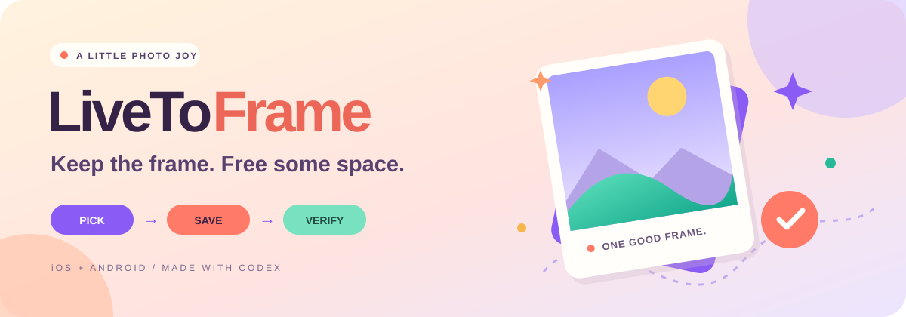

<div align="center">



# LiveToFrame · 实况转静态

**把喜欢的瞬间留下，给相册腾一点呼吸的空间。**

批量选片 → 保存静态副本 → 回读核验 → 由你确认移除原件


[✨ 看看能做什么](#-相册减负小分队) · [🚀 本地运行](#-把项目跑起来) · [🎨 设计与原型](#-从想法到界面)

</div>

---

## 🍊 好照片，值得留下来

有些实况照片，最喜欢的就是封面那一帧。

LiveToFrame 是一个 iOS / Android 双端相册工具：从支持的实况照片中保存静态副本，核验写入结果，再把是否移除动态原件的决定交给你。整理一批照片时，可以按日浏览、批量勾选，也可以长按预览，慢慢挑出想留下的瞬间。

> 📸 **留住这一帧。剩下的，确认好了再处理。**

## ✨ 相册减负小分队

| 成员 | 拿手好戏 |
| :--- | :--- |
| 🗓️ **按日选片员** | 五列照片网格，支持「按日 / 全部」浏览、当天批选和「只看已选」。 |
| ▶️ **瞬间放映员** | 长按预览动态内容，看看这张照片是否值得保留实况。 |
| 💛 **收藏守门员** | 提供收藏保护，整理之前先照顾好那些舍不得的照片。 |
| 🖼️ **静态保存员** | 优先提取可确认的封面静态数据；不支持或无法确认的项目明确跳过。 |
| 🔎 **副本检查员** | 写入后重新读取副本，核对对应格式的编码、尺寸、可读性等条件。 |
| 🧾 **进度记录员** | 记录逐张处理状态，提供结果查看与中断对账能力；恢复范围随平台不同。 |
| 🧹 **原件整理员** | 保存与移除分开操作，通过复核后，再由系统弹窗确认原件处理。 |

### 🧭 两端各有自己的地图

| | iOS | Android |
| :--- | :--- | :--- |
| 照片入口 | PhotoKit 授权范围内的 Live Photos | 当前聚焦内部存储 `DCIM/Camera/` 中带动态标记的 JPEG |
| 副本去向 | 系统照片图库，按可验证条件处理相册归属 | `Pictures/LiveToFrame/` |
| 内容筛选 | 提供人物、风景、文字等端侧场景筛选 | 内容分类尚待扩展 |
| 中断处理 | 恢复逐张写入记录，重新核验已有副本；未开始项需重新选片 | 提供批次继续处理入口，复用已核验副本 |
| 原件处理 | 复核通过后提交系统移除确认 | 复核通过后提交系统回收站确认 |

Android 已有 OPPO Find X8 Ultra 系列样本与真机验证记录，更多品牌、编辑过或更换封面的照片仍需逐项验证。具体覆盖范围见 [Android 构建与验证记录](docs/Android-首版构建计划.md)。

## 🫧 每一步，都有回声

```text
🗂️ 选出想整理的实况照片
       ↓
🖼️ 保存新的静态副本          原件仍在
       ↓
🔎 回读并核验副本            不确定就停下来
       ↓
🧾 查看逐张结果与原件清单
       ↓
🙋 你决定是否继续处理原件
       ↓
📱 系统再次确认              通过复核的项目才会提交
```

- **保存副本后，原件仍在相册。** 原件处理需要单独发起，并重新核对资产与副本状态。
- **取消、失败或结果无法确认时，保留原件或标为待核对。** 不把「写入请求成功」直接当成「副本核验通过」。
- **空间数字是估算。** 系统最近删除 / 回收站、云端同步和设备统计会影响实际可用空间。

## 🚀 把项目跑起来

### 🍎 iOS

准备 macOS、支持 iOS 17 及以上目标的 Xcode；真机运行时，在 Signing & Capabilities 中选择自己的开发团队。

1. 打开 `ios/LiveToFrame.xcodeproj`。
2. 选择 `LiveToFrame` Scheme 和运行设备。
3. 运行应用，按需授予照片访问权限。

也可以从仓库根目录构建：

```bash
xcodebuild \
  -project ios/LiveToFrame.xcodeproj \
  -scheme LiveToFrame \
  -destination 'generic/platform=iOS' \
  build
```

`ios/project.yml` 是 XcodeGen 工程配置；如需重新生成工程，安装 XcodeGen 后在 `ios/` 下运行 `xcodegen generate`。已有工程可直接用 Xcode 打开。

### 🤖 Android

准备 Android Studio、JDK 17、Android SDK Platform 36 和 Build Tools 36.0.0。最低运行版本为 Android 11（API 30）。

1. 用 Android Studio 打开 `android/`。
2. 配置本机 Android SDK 路径，完成 Gradle 同步。
3. 连接设备，运行 `app` 模块。

或使用仓库自带的 Gradle Wrapper：

```bash
cd android
./gradlew :app:assembleDebug
```

调试安装包输出到 `android/app/build/outputs/apk/debug/`。

### 🧪 已有测试入口

| 平台 | 仓库中的测试 |
| :--- | :--- |
| iOS | 转换安全单元测试、相册手势 UI 测试 |
| Android | Motion JPEG 解析、扫描索引、回收站策略单元测试 |

Android 单元测试可运行 `cd android && ./gradlew :app:testDebugUnitTest`。iOS 测试可在 Xcode 中选择合适的测试设备后运行。涉及图库授权、封面、HDR 和系统移除确认的行为，还需要在对应真机上验证。

## 🎨 从想法到界面

这个项目也记录了一次 **Vibe Coding 实践**：用 Markdown 写下需求、交互规则和验收标准，用 HTML 原型讨论体验，再与 Codex 协作完成双端实现，结合真机反馈持续迭代。

| 想逛哪里 | 入口 |
| :--- | :--- |
| 🧩 交互游乐场 | [双平台 HTML 原型](docs/LiveToFrame-Prototype.html) · 下载仓库后用浏览器打开，可切换 iOS / Android；其中部分交互是设计提案 |
| 🌈 视觉调色盘 | [跨平台视觉与交互设计规范](docs/跨平台视觉与交互设计规范.md) |
| 📐 产品说明书 | [跨平台产品与工程规范](docs/跨平台产品与工程规范.md) |
| 🛠️ 最初的蓝图 | [实况转静态 · 产品与技术方案](实况转静态-产品与技术方案.md) |
| 📓 迭代手账 | [工作日志](工作日志.md) |

## 🧰 打开工具箱

```text
livetoframe/
├── ios/                         # SwiftUI · PhotoKit · 转换与核验
│   ├── LiveToFrame/              # 应用源码与图标
│   ├── LiveToFrameTests/         # 转换安全测试
│   ├── LiveToFrameUITests/       # 相册交互测试
│   └── project.yml              # XcodeGen 配置
├── android/                     # Kotlin · Compose · MediaStore
│   └── app/src/                  # 应用源码、资源与单元测试
├── docs/                        # 双平台原型、设计规范与验证记录
├── 实况转静态-产品与技术方案.md
└── 工作日志.md
```

<div align="center">


**让相册轻一点，让喜欢的瞬间多留一会儿。**

🍊 🟣 🌿 📸

</div>
